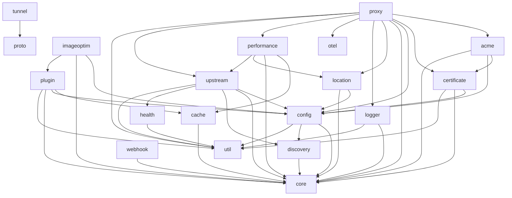

# Pingap Modules

> WAFred's workspace contains the upstream `pingap-*` crates below **plus**
> seven WAF-specific crates. The two are listed separately in
> [docs/README.md](README.md#-crate-documentation): `pingwaf-proto`,
> `pingwaf-server`, `wafred-agent`, `pingwaf-waf`, `pingwaf-challenge`,
> `pingwaf-profiler`, `pingwaf-system` and `wafred-tunnel`.

## Trust boundaries

WAFred adds a control plane on top of the pingap proxy engine. The security
model rests on the boundaries below; a change that lets one side reach the
other's data is a security regression, not a feature. The hardening steps for
each boundary are in [`SECURITY.md`](../SECURITY.md#hardening-checklist).

### Control plane (`pingwaf-server`)

Holds PostgreSQL, every tenant's configuration and logs, administrator
credentials, the JWT signing secret and the `WAFRED_SECRET_KEY` used to seal
stored secrets. It is reachable only by:

- **administrators** over the console/API (TLS, self-signed until a real
  certificate is uploaded; published on `127.0.0.1` by default) — see
  [deployment.md](deployment.md);
- **agents** over the gRPC control plane with a per-node API key; an
  enrolment key carries the `agent` permission only, never a console `read`
  grant;
- **MCP clients** over `/mcp`: a `read` key sees only the sites its owner owns,
  only a `write` key whose owner is an administrator is fleet-wide — see
  [api.md → MCP server](api.md#mcp-server).

### Data plane / agent (`wafred-agent`)

Holds only what it serves: the bundle for its own sites (including those sites'
TLS private keys and OIDC secrets), its agent token, and a `0600` local rule
cache. It has **no database access and no control-plane read surface** — it
pushes logs/events/metrics and receives configuration over the authenticated
gRPC stream (TLS with the control-plane CA by default). Disconnected behaviour
is explicit: fail-open (keep serving the last bundle) or fail-closed (refuse
hosts without a synced bundle), configurable per site and globally.

The data plane also ships as its own binary, `wafred-agent`
(`src/edge_main.rs`, `--features edge`): the same agent and proxy with the
control-plane modules and the dashboard-embedding admin plugin compiled out.
`install.sh --mode agent` installs it; it never links `pingwaf-server`.

### Tunnel connector (`wafred-tunnel`)

The connector runs **inside** the private network and holds the credential for
one tunnel plus the list of targets it may dial. It has no database access and
no control-plane read surface: it pairs once (`PairTunnel`), then holds a
`TunnelControl` stream for policy and pushes nothing but heartbeats.

The edge half of the same crate (`server`/`registry`, always compiled into the
agent) accepts those sessions. It never sees the connector's credential: the
control plane mints a **short-lived Ed25519 session token**, the connector
presents it, and the edge verifies it against the public key that arrived in
the rule bundle. A compromised edge therefore learns a token that expires
(one hour by default) and is bound to one tunnel. The edge opens a data stream
only for a target one of its own sites references. The two halves share one
wire protocol (`protocol.rs`) so a change to a frame cannot land on one side
only.

### PostgreSQL

The database is a **secret store**: site TLS private keys, HTTP basic-auth
credentials in clear text, OIDC cookie secrets, the generated JWT secret and
the sealed channel/AI/backup credentials all live there. At-rest sealing of the
last group depends on `WAFRED_SECRET_KEY`; without it those fields are clear
text. Backups and replicas must be protected like the control plane itself —
see [deployment.md → Backup & Recovery](deployment.md#backup--recovery).

### Browser / console

The dashboard is served from the same origin as the API and authenticates with
a bearer JWT; it relies on the response security headers
([api.md → Response security headers](api.md#response-security-headers)) and on
passkeys requiring a secure context (HTTPS or `localhost`). Sessions are bound
to an account token version, so a password change, role change, disable or
`wafred user reset-password` revokes them immediately.

### Third parties

Everything that leaves the deployment is operator-configured and should be
reviewed as an egress path:

| Destination | What is sent | Notes |
| --- | --- | --- |
| AI provider (OpenAI-compatible) | Chat messages and MCP tool results: site metadata, access logs, WAF events, and for administrators control-plane audit entries | Only when the assistant is enabled; write tools are off by default. See [user-guide.md → AI Assistant](user-guide.md#ai-assistant) |
| Webhooks (WeCom/DingTalk/generic) | Alert title/message/details | URLs are SSRF-checked against private ranges |
| SMTP relay | Notification e-mails | Credentials sealed with `WAFRED_SECRET_KEY` |
| Elasticsearch | The same log documents as PostgreSQL (headers and bodies included) | Optional shipper; index retention is independent |
| ACME / DNS provider, GeoIP | Certificate order data / login IPs | Credentials sealed; GeoIP URL is SSRF-checked |

### Data-flow summary

| Source → destination | Transport | Contents | Trust assumption |
| --- | --- | --- | --- |
| Browser → control plane | HTTPS (bearer JWT / passkey) | Config, logs, users | Administrator or scoped role; TLS verified by the browser |
| Agent → control plane | gRPC over TLS | Heartbeats, logs, cert events, metrics | Per-agent key; revocation stops the stream |
| Control plane → agent | gRPC over TLS | Rule bundle (may include TLS keys) | Agent verifies the control-plane certificate |
| Control plane → PostgreSQL | private network / loopback | Everything | DB is a secret store |
| Control plane → third party | HTTPS/HTTP per integration | See table above | Operator configured; egress is auditable |
| Data plane → origin | HTTP/HTTPS | Proxied traffic | `verify_cert` tri-state, per pool/global |

The request pipeline itself (which plugin sees which stage) is documented in
[http-lifecycle.md](http-lifecycle.md).

- `acme`: Handles Automated Certificate Management Environment (ACME) protocol for automated SSL/TLS certificate issuance and renewal
- `cache`: Manages caching mechanisms for improved performance and reduced backend load
- `certificate`: Handles SSL/TLS certificate management, storage, and validation
- `config`: Provides configuration management and parsing functionality
- `core`: Contains essential functionality and shared components used across other modules
- `discovery`: Implements service discovery mechanisms for dynamic backend detection
- `health`: Manages health checks and monitoring of backend services
- `location`: Handles URL routing and location-based request processing
- `logger`: Provides logging functionality and log management
- `otel`: Implements OpenTelemetry integration for distributed tracing and metrics
- `performance`: Provides performance metrics 
- `proxy`: Proxy server for pingap
- `plugin`: Manages plugin system for extending functionality
- `pyroscope`: Integrates with Pyroscope for continuous profiling
- `sentry`: Provides error tracking and monitoring via Sentry integration
- `upstream`: Manages backend server connections and load balancing
- `util`: Contains shared utility functions and helper methods
- `webhook`: Supports several webhook protocols for sending notifications to external services
- `imageoptim`: Image optimize, which supports png, jpeg, webp and avif

